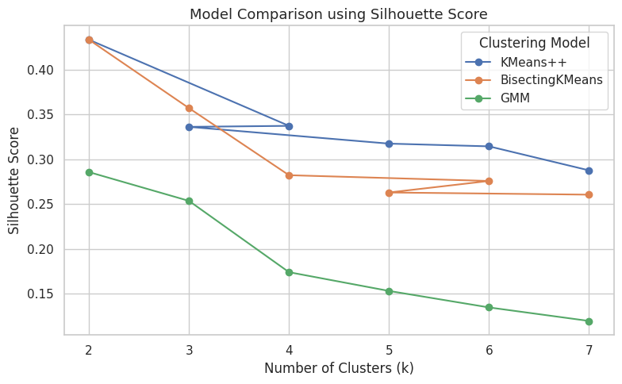
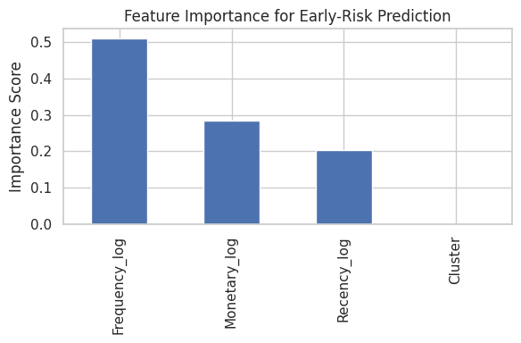
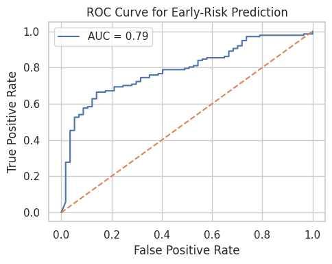
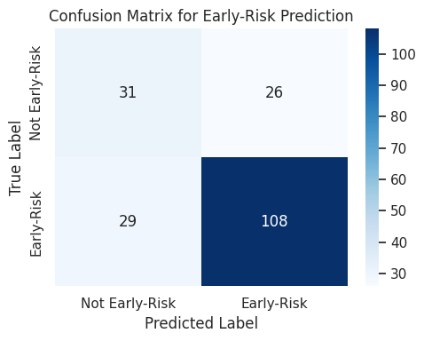
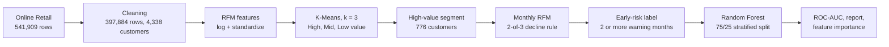

<div align="center">
  

  <p><code>Early warning model for high-value customer drop-off using RFM segmentation, K-Means and Random Forest on UCI Online Retail.</code></p>

  <a href="https://github.com/Saji-d/rfm-based-customer-segmentation-and-early-risk-prediction"></a>
  
  
  <br>
  
  
  
  
  
  

  <p>
    <a href="#-overview">Overview</a> ·
    <a href="#-highlights">Highlights</a> ·
    <a href="#-preview">Preview</a> ·
    <a href="#-pipeline">Pipeline</a> ·
    <a href="#-results">Results</a> ·
    <a href="#-tech-stack">Tech Stack</a> ·
    <a href="#-getting-started">Getting Started</a> ·
    <a href="#-project-structure">Structure</a> ·
    <a href="#-roadmap">Roadmap</a> ·
    <a href="#-author">Author</a>
  </p>
</div>


## ◈ Overview

Churn is usually treated as a black-box yes or no. This project takes a more interpretable route: first segment customers by value with RFM (Recency, Frequency, Monetary), then watch only the high-value segment for signs of fading engagement, and finally train a model that predicts which of those customers are at early risk.

It uses the public [UCI Online Retail](https://archive.ics.uci.edu/dataset/352/online+retail) dataset and supports an academic paper that is still in preparation. Everything lives in one notebook, so the whole method can be read and rerun top to bottom.

> [!NOTE]
> This is a research prototype. The early-risk label is a rule computed from the same transactions that feed the features and the train and test split is random, so the scores below describe how well the model reproduces that rule. They are not a forecast of real future churn. See the [Roadmap](#-roadmap) for the planned fix.


## ◈ Highlights

<table>
  <tr>
    <td width="33%"><b>RFM feature engineering</b><br>Recency, Frequency and Monetary per customer, log-transformed and standardized.</td>
    <td width="33%"><b>Clustering benchmark</b><br>K-Means++, Bisecting K-Means and GMM compared for k from 2 to 7 by silhouette and Davies-Bouldin.</td>
    <td width="33%"><b>Value segments</b><br>Three data-driven segments (High, Mid and Low value) from K-Means with k = 3.</td>
  </tr>
  <tr>
    <td><b>Monthly decline signals</b><br>A 2-of-3 rule over falling frequency, falling spend and rising recency flags a warning month.</td>
    <td><b>Early-risk label</b><br>A high-value customer with two or more warning months is labelled early-risk.</td>
    <td><b>Interpretable model</b><br>Random Forest with feature importances that show frequency and spend dominate.</td>
  </tr>
</table>


## ◈ Preview

<table>
  <tr>
    <td align="center"><br><sub>Clustering comparison by silhouette score</sub></td>
    <td align="center"><br><sub>Feature importance of the early-risk model</sub></td>
  </tr>
  <tr>
    <td align="center"><br><sub>ROC curve on the held-out 25% (AUC 0.79)</sub></td>
    <td align="center"><br><sub>Confusion matrix on the held-out 25%</sub></td>
  </tr>
</table>


## ◈ Pipeline



**Cleaning.** Rows without a customer id, cancelled invoices (starting with C) and rows with non-positive quantity or price are removed. Revenue is `Quantity * UnitPrice`.

**Warning rule.** For each high-value customer and each active month, a warning is raised when at least two of these three hold against the previous active month: frequency fell, monetary value fell, recency rose.


## ◈ Results

All values come from the outputs saved in the notebook.

| Step | Result |
|---|---|
| Customers after cleaning | 4,338 (1 Dec 2010 to 9 Dec 2011) |
| Best silhouette (k = 2) | 0.433 for K-Means++ |
| Chosen k = 3 | silhouette 0.336, used for interpretability |
| High-value segment | 776 customers (17.89%), average 13.3 orders and 7,866 spend, recency 17 days |
| Mid-value segment | 1,696 customers (39.10%) |
| Low-value segment | 1,866 customers (43.02%), recency 168 days |
| Early-risk base rate | 70.9% of high-value customers |

**Early-risk model** (Random Forest, 300 trees, depth 8, balanced class weights, 194 test customers):

| Metric | Value |
|---|---:|
| ROC-AUC | 0.788 |
| Accuracy | 0.72 |
| Early-risk precision and recall | 0.81 and 0.79 |
| Not-early-risk precision and recall | 0.52 and 0.54 |
| Feature importance | Frequency 0.51, Monetary 0.28, Recency 0.20, Cluster 0.00 |


## ◈ Tech Stack

| Layer | Technologies | Purpose |
|---|---|---|
| Data | pandas, NumPy | Cleaning, RFM and monthly aggregation |
| Segmentation | scikit-learn (KMeans, BisectingKMeans, GaussianMixture) | Customer value clusters and quality metrics |
| Prediction | scikit-learn (RandomForestClassifier) | Early-risk classifier |
| Visualisation | Matplotlib, Seaborn | Silhouette plot, confusion matrix, ROC and importances |
| Environment | Jupyter, Google Colab | The notebook reads the data from Google Drive |


## ◈ Getting Started

**Prerequisites:** Python 3 and the dataset file `Online Retail.xlsx` from the [UCI repository](https://archive.ics.uci.edu/dataset/352/online+retail) (not bundled here).

```bash
git clone https://github.com/Saji-d/rfm-based-customer-segmentation-and-early-risk-prediction.git
cd rfm-based-customer-segmentation-and-early-risk-prediction
pip install pandas numpy scikit-learn matplotlib seaborn openpyxl jupyter
jupyter notebook notebook/rfm-early-risk-prediction.ipynb
```

The notebook was written for Google Colab and mounts Google Drive in its first cells. To run locally, skip the Drive cell and point `file_path` in the data loading cell to your copy of `Online Retail.xlsx`.


## ◈ Project Structure

```text
.
├── notebook/
│   └── rfm-early-risk-prediction.ipynb   # full pipeline with saved outputs
├── docs/figures/                         # figures exported from the notebook
├── assets/                               # banner and divider
├── LICENSE                               # MIT
└── README.md
```


## ◈ Roadmap

- [x] RFM segmentation with a clustering model comparison
- [x] Monthly decline rule and early-risk label for high-value customers
- [x] Random Forest baseline with feature importances
- [ ] Separate feature and label windows in time so the label is a true future event
- [ ] Chronological train and test split instead of a random one
- [ ] Compare more models, such as gradient boosting, against the Random Forest baseline
- [ ] Publish the accompanying paper


## ◈ Author

**Sajidur Rahman Sajid**, Full-Stack Developer and AI engineer from Dhaka. BSc in Computer Science and Engineering.

[Portfolio](https://www.sajidur.me) · [LinkedIn](https://www.linkedin.com/in/sajidur-rahman-sajid/) · [GitHub](https://github.com/Saji-d) · [Email](mailto:sajidsajidurrahman99@gmail.com)

<sub>Released under the MIT licence.</sub>
